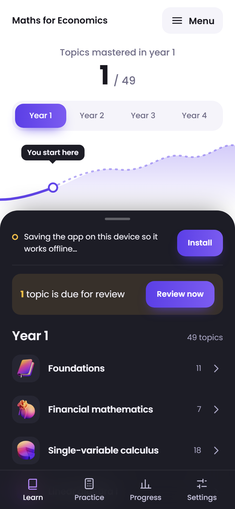
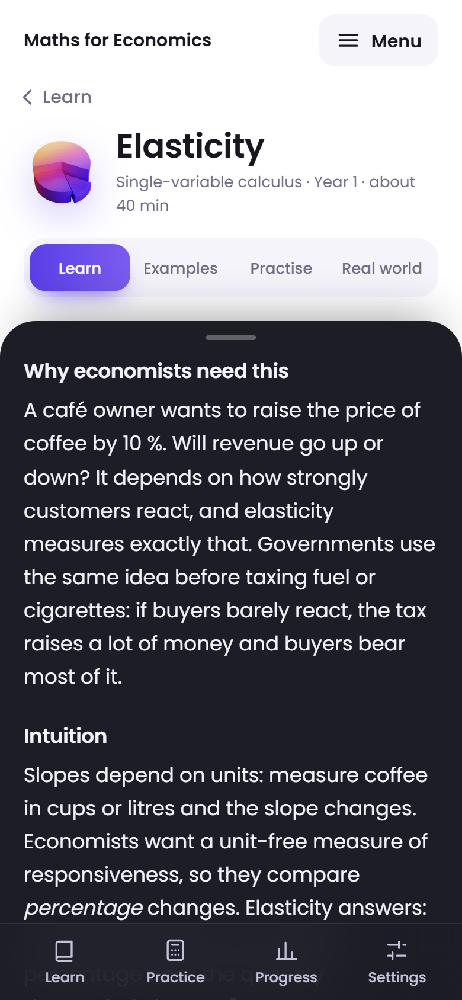
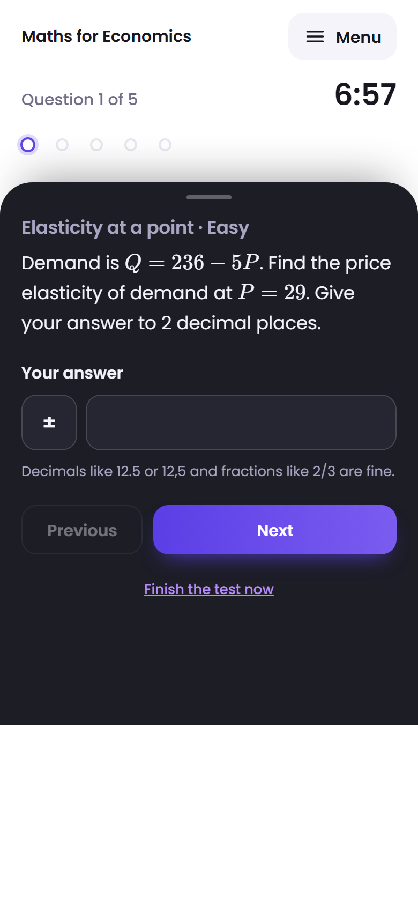
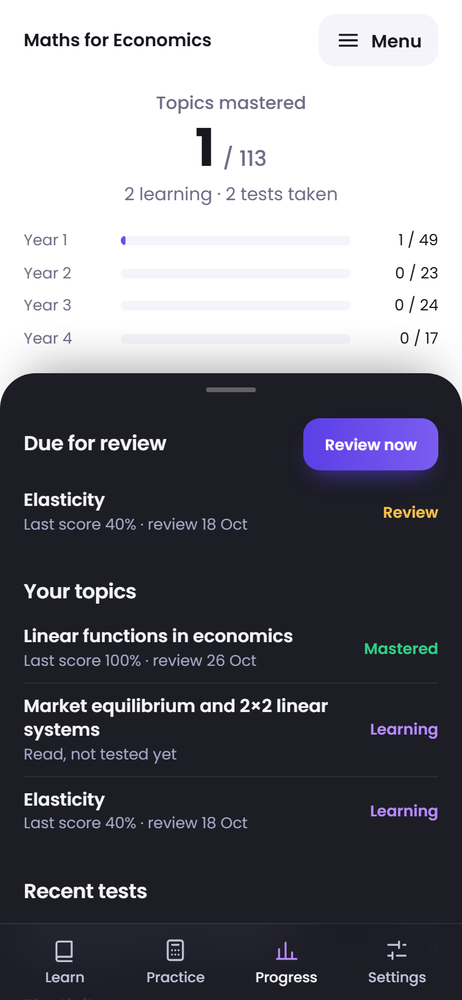

# Maths for Economics

A free, open-source, offline-first app that teaches the mathematics of an economics degree, from first year to final year.

**Open it:** https://maths-for-economics.ibragim-n.workers.dev (on a phone, add it to the home screen to install it and use it offline).

<p>
  
  
  
  
</p>

- Every topic explained through how economists use it, with worked examples and interactive graphs
- Unlimited practice: answers computed and checked by code, never by AI
- Timed tests with offline explanations of the mistakes you made, and spaced review
- An AI tutor that explains ideas and steps, but does not do your homework (unless you use your own free key)
- Follows your programme: Core, Azerbaijan, or tracks modeled on LSE, Cambridge and MIT, or your own imported track
- Progress you can share with a parent or tutor through a private, read-only link, if you choose
- Works without internet; no ads, no accounts, no tracking

Status: in development. Year 1 topics are being written; see [docs/08-roadmap.md](docs/08-roadmap.md).

## Run it on your computer

You need [Node.js](https://nodejs.org) 24 or newer and Git.

```sh
git clone https://github.com/ibragims-niso/maths-for-economics.git
cd maths-for-economics
npm install
npm run dev
```

Then open http://localhost:5173.

| Command | What it does |
|---|---|
| `npm run dev` | Start the web app locally |
| `npm run dev:proxy` | Run the Cloudflare Worker (built app + API) locally on port 8790; copy `.dev.vars.example` to `.dev.vars` first. `npm run dev` forwards `/api` to it |
| `npm test` | Unit and property-based tests |
| `npm run test:e2e` | Key flows in a real browser (Playwright) |
| `npm run validate:content` | Check all content: schemas, `verify` blocks, prerequisite graph, tracks |
| `npm run validate:track <file>` | Check one track file, e.g. a private one in `local/tracks/` |
| `npm run check:links` | Open every resource and source link |
| `npm run check:guardrails` | Send 20 sample questions to the live AI and check none gets its homework answered |
| `npm run lint` / `npm run format` | Check / fix code style (Biome) |
| `npm run typecheck` | TypeScript type check |
| `npm run build` | Validate content, then build the web app into `apps/web/dist` |

## Repository layout

```
apps/web/        the app (React + Vite PWA)
apps/proxy/      the API (AI tutor, limits and cache, mentor sharing), served by the same Worker under /api
packages/core/   shared logic: generators, grading, mastery, AI prompts and guardrails, content checks
scripts/         content build and checks
content/         topics, topic bank, tracks, glossary
config/          AI models and limits
docs/            specification and decisions
```

## Contributing

Found a mistake, or know a good free resource? See [CONTRIBUTING.md](CONTRIBUTING.md). You can report an error straight from the app.

## Licences

Code: MIT ([LICENSE](LICENSE)). Content in `content/`: CC BY-NC-SA 4.0 ([content/LICENSE](content/LICENSE)). University tracks are unofficial and not endorsed by the universities.

## For developers

Start with [CLAUDE.md](CLAUDE.md), then [docs/](docs/).
